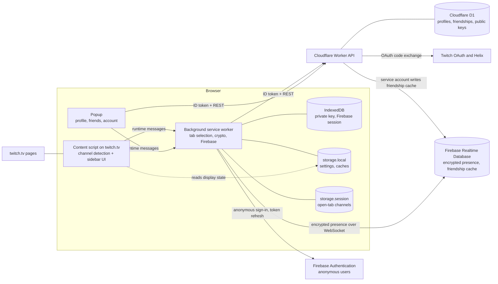
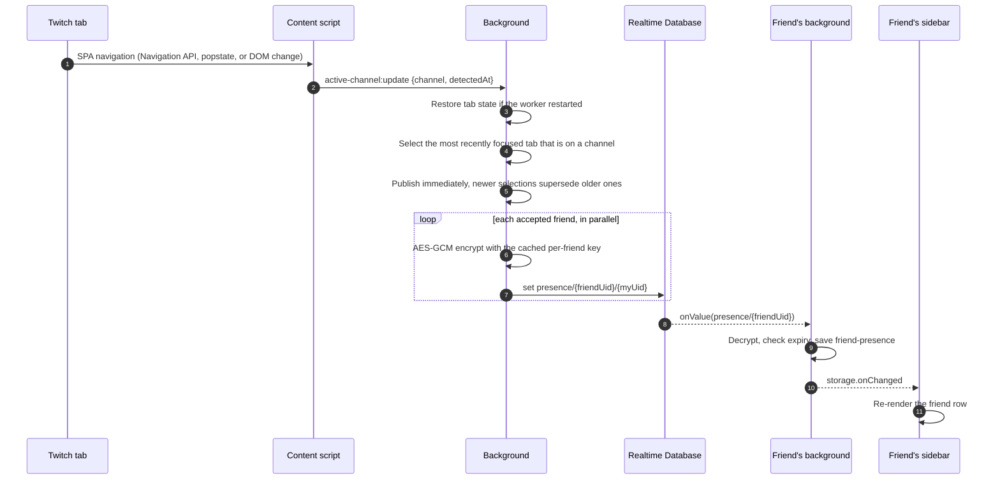
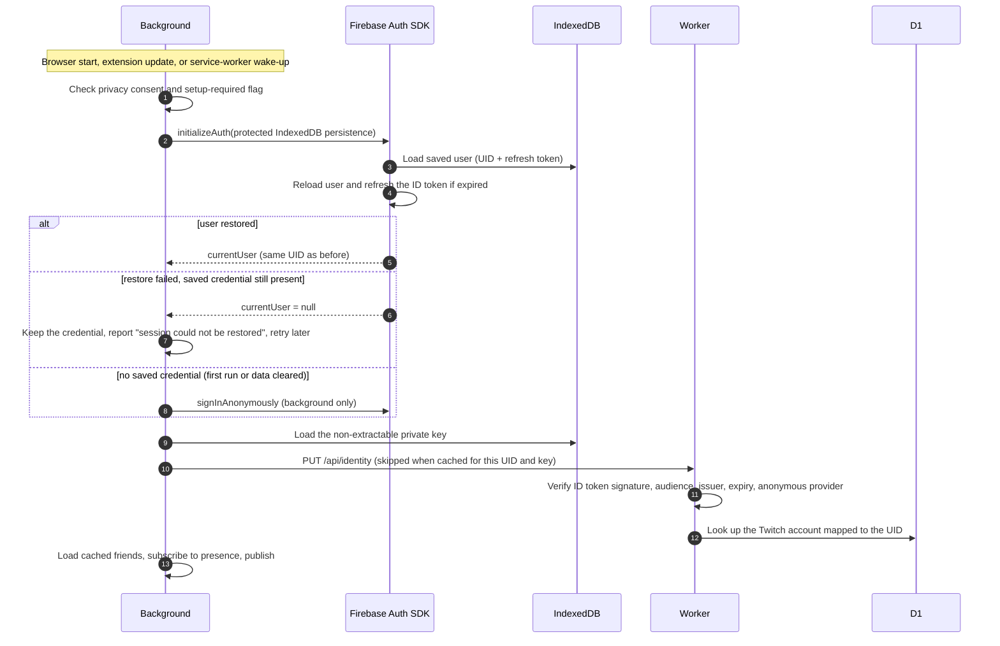
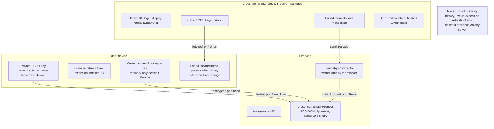
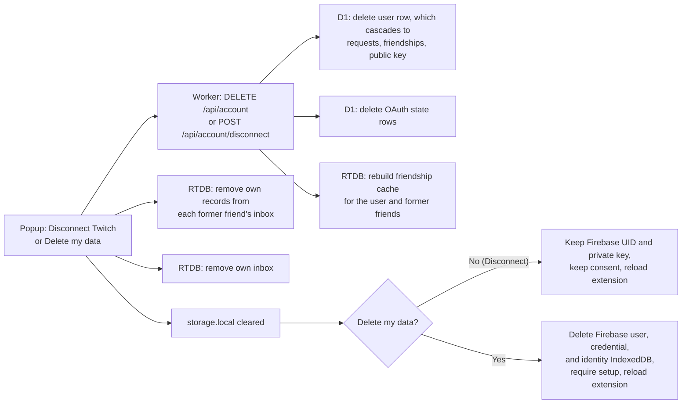

# Twitch Friends

> Design status: this is the proposed end-state, not the behavior currently merged into `main`. Session persistence is tracked in PR #2, scoped Worker synchronization in PR #3, and navigation detection in PR #1. Tab tracking, publisher/receiver retries, caches, alarm heartbeats, and timing instrumentation remain unmerged work. Commands and test coverage in this design are proposals; use the [root README](../README.md) for commands available on `main`.

Twitch Friends is a browser extension that adds a **Friends** section to the Twitch sidebar. People
who accepted each other as friends can see which live channel the other person is watching. Presence
is end-to-end encrypted for each friend and expires after about one minute. No viewing history is
created.

The project is in closed beta. Chrome (Manifest V3) is the supported beta target. Firefox (Manifest
V2) builds and is tested, but its per-install `moz-extension://` origin is not yet allowed by the
production Worker.

## Contents

- [Features](#features)
- [Architecture](#architecture)
- [Presence: what happens on a channel switch](#presence-what-happens-on-a-channel-switch)
- [Sessions and identity](#sessions-and-identity)
- [Security and privacy](#security-and-privacy)
- [Requirements](#requirements)
- [Local development](#local-development)
- [Commands](#commands)
- [Testing](#testing)
- [Production release](#production-release)
- [Known limitations](#known-limitations)
- [Troubleshooting](#troubleshooting)
- [Repository structure](#repository-structure)

## Features

- Twitch sidebar section with friends, their online state, and a link to the channel they watch.
- Channel detection for Twitch single-page navigation, raids, redirects, reloads, and several tabs.
- Twitch account ownership verified with Twitch OAuth in a Cloudflare Worker.
- Friend requests: send, accept, decline, cancel, and remove. At most 100 friends per account.
- Presence encrypted separately for each friend with ECDH P-256, HKDF-SHA-256, and AES-256-GCM.
- Private keys generated as non-extractable WebCrypto keys and stored only on the device.
- Anonymous Firebase Authentication. There is no password or email.
- Popup with runtime status, profile connection, friends management, **Disconnect Twitch**, and
  **Delete my data**.
- First-run privacy disclosure. Remote services start only after the user accepts it.

## Architecture



| Component                                     | Responsibility                                                                                                                   |
| --------------------------------------------- | -------------------------------------------------------------------------------------------------------------------------------- |
| Content script (`src/entrypoints/content.ts`) | Detects the Twitch channel in the tab and renders the sidebar from local storage. It never sees tokens, keys, or ciphertext.     |
| Background (`src/entrypoints/background.ts`)  | Chooses which tab controls presence, owns the Firebase session, encrypts and publishes presence, and decrypts incoming presence. |
| Popup (`src/entrypoints/popup`)               | Consent, Twitch connection, friend management, and account actions.                                                              |
| Worker (`worker/src`)                         | Verifies Firebase ID tokens, runs Twitch OAuth, stores data in D1, and maintains the Realtime Database friendship cache.         |
| D1 (`worker/migrations`)                      | Source of truth for profiles, friend requests, friendships, and public keys.                                                     |
| Realtime Database (`firebase/rules`)          | Delivers per-friend encrypted presence. Access is enforced by Rules.                                                             |

## Presence: what happens on a channel switch



Publishing rules:

- **No debounce.** A different channel login starts a publish immediately.
- **Newest wins.** One publish pass runs at a time. Changes during a pass trigger one more pass
  with the latest channel. A record whose encryption finished after a newer selection is not
  written.
- **No duplicate writes.** Repeated reports for the same channel only refresh a record that is at
  least 25 seconds old. Records expire after 60 seconds.
- **Failures are retried.** Only acknowledged writes count as published. Retries back off after
  1, 2, 5, 10, and 20 seconds. A single Firebase write times out after 10 seconds.
- **Leaving is graceful.** When no Twitch tab is on a channel, records are removed after a
  3-second grace period, so a reload does not flicker.
- **Restart safe.** The open Twitch tabs and their current channel logins are kept in
  `storage.session`, which is memory-only. Friend IDs that may still hold a record are also kept
  there. A restarted service worker restores both before it publishes or clears anything.
- **Heartbeat.** Content scripts report every 10 seconds. A `chrome.alarms` alarm fires every 30
  seconds while a channel is selected, because timers do not survive service-worker suspension.

Tab selection: the tab the user most recently brought to the foreground, in the focused window,
controls presence. If that tab closes or leaves a channel, the next most recently focused Twitch tab
that is on a channel takes over. A tab that has not reported for 90 seconds is treated as closed.
When the browser loses focus to another application, presence stays on the current tab.

Friend list updates: the background caches friend IDs and public keys in `storage.local` and listens
to its server-managed `friendships/{uid}` node. The Worker updates that node on every friendship
change. A change there triggers a refresh, so a new or removed friend takes effect without
reopening the popup. A restart with valid caches makes no Worker requests.

Development builds (`npm run dev`) log stage timings to the background console as
`[Twitch Friends][timing]`. They cover content detection to background selection, selection to
Firebase acknowledgement, and the friend's write to local decode. The last one is only meaningful
when both profiles run on the same machine. Production builds contain no timing code.

## Sessions and identity



What is kept, and where:

| Data                                                                  | Storage                                               | Survives restart, update    | Removed by                                          |
| --------------------------------------------------------------------- | ----------------------------------------------------- | --------------------------- | --------------------------------------------------- |
| Firebase user (UID, refresh token)                                    | Extension IndexedDB, managed by the Firebase SDK      | Yes                         | Delete my data, uninstall, clearing extension data  |
| ECDH private key                                                      | Extension IndexedDB, as a non-extractable `CryptoKey` | Yes                         | Delete my data, uninstall, clearing extension data  |
| UID to Twitch account mapping                                         | D1                                                    | Yes                         | Disconnect Twitch, Delete my data                   |
| Consent, friend list for display, friend presence for display, caches | `storage.local`                                       | Yes                         | Disconnect Twitch, Delete my data, uninstall        |
| Open Twitch tabs and their channel logins                             | `storage.session` (memory only)                       | Service-worker restart only | Tab close, browser exit, extension reload or update |

Expected behaviour:

| Event                                            | Result                                                                                                                                                                                                                      |
| ------------------------------------------------ | --------------------------------------------------------------------------------------------------------------------------------------------------------------------------------------------------------------------------- |
| ID token expires (every hour)                    | Refreshed silently by the Firebase SDK with the stored refresh token.                                                                                                                                                       |
| Service worker suspended and restarted           | Same UID, same key. Presence resumes from `storage.session`.                                                                                                                                                                |
| Browser closed and reopened                      | Same UID, same key. Presence starts when a Twitch tab reports a channel.                                                                                                                                                    |
| Extension updated                                | Same UID and key. `storage.session` is cleared, and tabs re-report within 10 seconds.                                                                                                                                       |
| Offline at startup                               | The SDK keeps the user on network errors. Other restore errors no longer delete the saved credential. Start is retried every minute.                                                                                        |
| Firebase user deleted or disabled on the server  | The background never silently creates a replacement UID. **Connect Twitch** explicitly replaces the unusable credential and proves ownership through OAuth again. Friendships are kept because they are keyed by Twitch ID. |
| Disconnect Twitch                                | Server mapping, friendships, requests, public key, and presence are removed. The UID and private key stay on the device.                                                                                                    |
| Delete my data                                   | Same as Disconnect, plus the Firebase user, the private key, and local storage are deleted.                                                                                                                                 |
| Uninstall, or clearing the extension's site data | The UID and private key are lost. Connect Twitch again to restore the account mapping.                                                                                                                                      |

Details and the root cause of earlier session loss are in
[docs/session-persistence.md](session-persistence.md).

## Security and privacy



- The Twitch page, content script, and Worker never receive private keys or plaintext presence.
- Realtime Database Rules allow a presence write only when both friendship cache edges exist. They
  limit the record to four fields and cap its expiry at two minutes. Only the recipient can read the
  inbox, and only the sender can delete their own record.
- Only the Worker writes the friendship cache, using the D1 friendship table as the source.
- Twitch OAuth uses a 256-bit single-use state, stored as a SHA-256 hash and bound to the UID, that
  expires after ten minutes. Twitch tokens are revoked right after verification and never stored.
- The Worker accepts only RS256 Firebase ID tokens for the configured project with the anonymous
  provider. Every request is rate-limited per UID and per IP, and there is a daily service budget.



The full model is in [docs/security-architecture.md](security-architecture.md).

## Requirements

- Node.js 22 or newer and npm 11 or newer
- Java 21 or newer for the Firebase emulators
- Chrome 120 or newer, or Firefox 140 or newer

## Local development

1. Install dependencies:

   ```bash
   npm ci
   ```

2. Create local configuration. Both files are ignored by Git.

   ```bash
   cp .env.example .env
   cp .dev.vars.example .dev.vars
   ```

   `.env` holds the public extension build settings. The defaults point at the local emulators:

   ```dotenv
   WXT_PUBLIC_BACKEND_URL=http://127.0.0.1:8787
   WXT_PUBLIC_FIREBASE_API_KEY=demo-api-key
   WXT_PUBLIC_FIREBASE_PROJECT_ID=demo-twitch-friends
   WXT_PUBLIC_FIREBASE_USE_EMULATORS=true
   ```

   `.dev.vars` holds Worker secrets for local development only. Add your own Twitch development
   application credentials:

   ```dotenv
   ALLOW_INSECURE_EMULATOR_AUTH=true
   FIREBASE_PROJECT_ID=demo-twitch-friends
   TWITCH_CLIENT_ID=<your-dev-client-id>
   TWITCH_CLIENT_SECRET=<your-dev-client-secret>
   TWITCH_OAUTH_CALLBACK_URL=http://localhost:8787/oauth/callback
   ```

   `ALLOW_INSECURE_EMULATOR_AUTH` only works with a `demo-` project ID. Never set it in production.

3. Start the services in separate terminals:

   ```bash
   npm run firebase:emulators
   npm run worker:migrate:local
   npm run worker:dev
   npm run dev
   ```

4. Load the extension:
   - Chrome: open `chrome://extensions`, enable Developer mode, choose **Load unpacked**, and
     select `.output/chrome-mv3-dev` (or `.output/chrome-mv3` for a production build).
   - Firefox: `npm run dev:firefox`, or load `.output/firefox-mv2/manifest.json` from
     `about:debugging`.

The emulator UI runs at `http://127.0.0.1:4000`. Emulator data is reset when the emulators stop, so
the extension creates a new anonymous user after an emulator restart. This does not happen in
production.

## Commands

| Command                                                   | Purpose                                                                    |
| --------------------------------------------------------- | -------------------------------------------------------------------------- |
| `npm run dev` / `npm run dev:firefox`                     | Development build with reload                                              |
| `npm run build` / `npm run build:firefox`                 | Production extension build                                                 |
| `npm run zip` / `npm run zip:firefox`                     | Package the extension                                                      |
| `npm run check`                                           | Comment policy, formatting, ESLint, TypeScript, extension and Worker tests |
| `npm run check:comments`                                  | Reject comments in first-party code and configuration                      |
| `npm test`                                                | Extension and script unit tests                                            |
| `npm run test:worker`                                     | Worker unit tests                                                          |
| `npm run test:rules`                                      | Realtime Database Rules tests in the emulator                              |
| `npm run firebase:emulators`                              | Start the Auth, Database, and Firestore emulators                          |
| `npm run firebase:rules:check`                            | Verify the Rules hash and the production project alias                     |
| `npm run firebase:rules:release`                          | Test, deploy, and smoke-check production Rules                             |
| `npm run worker:dev`                                      | Local Worker with local D1                                                 |
| `npm run worker:migrate:local`                            | Apply D1 migrations locally                                                |
| `npm run worker:build`                                    | Worker dry-run bundle                                                      |
| `npm run worker:migrate:remote` / `npm run worker:deploy` | Production D1 migrations and Worker deploy                                 |

## Testing

```bash
npm run check
npm run firebase:rules:check
npm run test:rules
npm audit --omit=dev --audit-level=high
npm run worker:build
npm run build
npm run build:firefox
```

The target CI workflow would run these steps; the current workflow does not include comment-policy or audit checks. Current CI on every push to `main` and on every pull
request. Actions are pinned to commit SHAs, and the workflow token is read-only.

The unit tests cover:

- Presence publisher: immediate publish, A to B to C coalescing, retries, and cleanup.
- Receiver: single subscription, expiry, and resubscribe after errors.
- Multi-tab selection: restart restore, window focus, and closing the active tab.
- Firebase session restoration: restart, temporary failure, revoked user, and extension pages.
- Identity recovery, account disconnect and deletion, and Worker routes.
- The comment checker (proposal only, not part of current `main`).

The Rules tests cover friendship-gated writes, cleanup after a friendship ends, expiry limits, and
forgery attempts.

## Production release

Order matters. A newer extension must never depend on a backend or Rules that is not deployed yet.

1. `npm run check`, `npm run test:rules`, and the builds above all pass.
2. Apply D1 migrations: `npm run worker:migrate:remote`.
3. Deploy the Worker: `npm run worker:deploy`. It needs the Cloudflare secrets `TWITCH_CLIENT_ID`,
   `TWITCH_CLIENT_SECRET`, and `FIREBASE_ADMIN_CONFIG`. The last one is JSON with `clientEmail`,
   `privateKey`, and the production `databaseUrl`.
4. Publish the extension build (`npm run zip`).
5. Only when the Rules file changed, after beta installations have updated:
   `npm run firebase:rules:release`.

The production OAuth redirect URL registered with Twitch is
`https://twitch-friends-api.yuravychivskii.workers.dev/oauth/callback`. Secrets must never be placed
in `WXT_PUBLIC_` variables, `wrangler.jsonc`, the repository, or issues.

## Known limitations

- **Uninstalling or clearing extension data** deletes the anonymous Firebase credential and the
  non-extractable private key. Neither can be recovered by design. Connect Twitch again to
  re-establish the account. Friendships are kept.
- **Server-side anonymous-user cleanup.** If the Firebase project enables Identity Platform's
  automatic deletion of old anonymous accounts, affected users must connect Twitch again. Check the
  project's Authentication settings.
- **Expired ciphertext can remain** in Realtime Database after a crash until the sender publishes
  again or the recipient's inbox is cleared. Clients ignore expired records, and Rules reject
  writes that expire more than two minutes ahead.
- **Muted background tabs.** Chrome throttles timers in hidden, silent tabs. Presence for such a tab
  is kept alive by the background alarm and is dropped after 90 seconds without reports.
- **Firefox** builds are tested but not yet allowed by the production Worker CORS configuration.
- **Key rotation.** When a friend recreates their key (Delete my data and reconnect), their records
  are undecryptable until the next friend refresh. Refresh runs on friendship changes, after an
  undecryptable record (at most every 5 minutes), and every 30 minutes.

## Troubleshooting

| Symptom                                                | Check                                                                                                                                                |
| ------------------------------------------------------ | ---------------------------------------------------------------------------------------------------------------------------------------------------- |
| Popup shows "Your saved session could not be restored" | Network or Firebase outage. The background retries every minute. If it persists, **Connect Twitch** replaces the unusable session.                   |
| Friends never appear online                            | Both users must accept each other. Open the popup and press **Refresh**. In development, check the background console for `[Twitch Friends]` errors. |
| Presence shows an old channel                          | Look for `[Twitch Friends][timing]` lines in a development build. The record refreshes within 25 seconds and expires after 60.                       |
| `Request limit reached`                                | Per-account hourly limits apply. Wait and retry.                                                                                                     |
| Rules tests fail to start                              | Java 21 must be on `PATH`, and ports 9000, 9099, and 8080 must be free.                                                                              |
| `npm run check:comments` fails                         | Remove the reported comment. Document the behaviour in `docs/` or express it in names and tests.                                                     |

## Repository structure

```text
src/
  entrypoints/          background, content script, popup
  features/
    presence/           detection, tab selection, publisher, receiver, crypto, sync wiring
    friends/            friend requests and local friend list
    profile/            Twitch connection and account actions
    privacy/            consent
    sidebar/            Twitch sidebar UI
  infrastructure/       backend client, Firebase app, auth, protected persistence, database
  security/identity/    non-extractable key generation and IndexedDB storage
  runtime/              runtime status and development timing
worker/
  src/                  Worker routes, Firebase token verification, D1 repository, Twitch client
  migrations/           D1 schema
firebase/rules/         Realtime Database and Firestore Rules, Rules tests, Rules hash
scripts/                Rules verification, smoke test, comment policy
docs/                   security architecture and session persistence
public/                 icons, privacy notice, beta terms
```

## Policies and contact

- [Privacy Notice](../public/privacy.html)
- [Beta Terms](../public/terms.html)
- [Roadmap](roadmap.md)
- Twitch: [LIVAY1337](https://www.twitch.tv/livay1337)
- Telegram: [@vychivsky](https://t.me/vychivsky)
- Email: [yuravychivskii@gmail.com](mailto:yuravychivskii@gmail.com)

Twitch Friends is an independent project and is not affiliated with Twitch Interactive, Inc.
